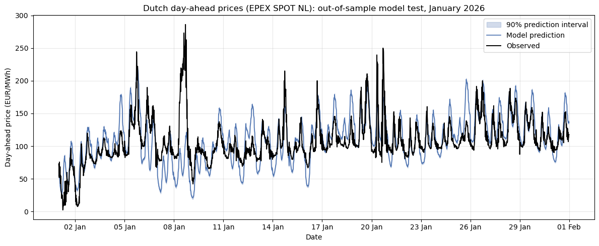

# NL DAY-AHEAD POWER PRICE FORECASTING
How predictable are Dutch day-ahead electricity prices given fundamentals, and under which market conditions does predictability break down?

## Market:
EPEX SPOT NL Day-Ahead

## Data and setup:
- Source: ENTSO-E Transparency Platform, BZN|NL, 15-minute MTU
- Training: 2025. Test: January 2026, out of sample
- Residual load = day-ahead load forecast minus day-ahead onshore wind, offshore wind and solar forecasts

## Models:
- Linear regression of price on residual load with hour and season effects and season-specific slopes
- Random Forest correction model on the linear model's errors
- XGBoost on residual load, hour and month
- Benchmarks: naive D-1 and D-7 (same slot one day and one week earlier)

## Results, January 2026 (EUR/MWh):
| Model | MAE | RMSE | rMAE vs D-1 |
|---|---|---|---|
| Naive D-1 | 21.9 | 33.7 | 1.00 |
| Naive D-7 | 24.4 | 38.9 | 1.12 |
| Linear | 20.1 | 28.5 | 0.92 |
| Linear + RF correction | 23.6 | 34.4 | 1.08 |
| XGBoost | 25.6 | 33.3 | 1.17 |

- The linear model beats the naive D-1 forecast by about 8%
- Neither ML model improves on it with these features
- Errors are higher at both ends of residual load (MAE about 28 in the top 5%, about 30 in the bottom 5%). In the highest-price 5% of slots MAE is about 55, mostly spikes residual load does not explain

## Limitations:
- One year of training data and one month of testing
- No gas or carbon price input, so the model cannot follow fuel price shifts such as the 2026 gas spike
- Cross-border flows and interconnector effects not modelled

## Next steps:
- Extend the test period through 2026
- Add TTF gas, EUA carbon and neighbouring-zone prices
- Piecewise residual load model for the steep part of the supply curve

