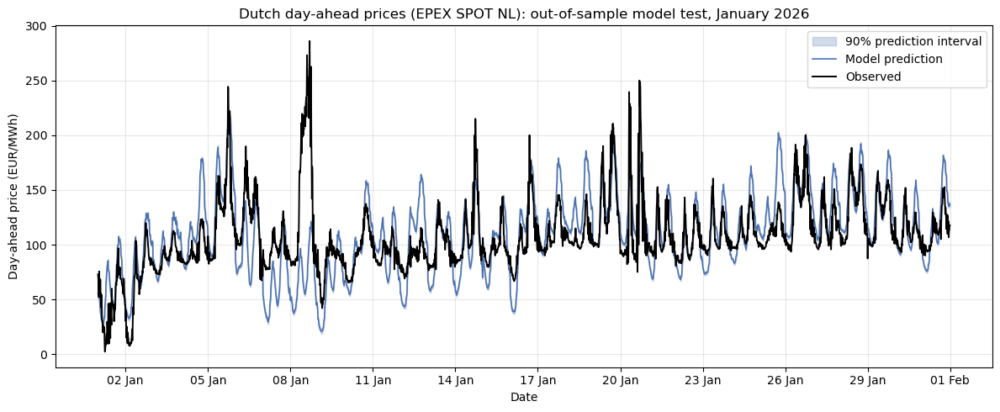

# NL DAY-AHEAD POWER PRICE FORECASTING
How predictable are Dutch day-ahead electricity prices given fundamentals, and under which market conditions does predictability break down?

## Market:
EPEX SPOT NL Day-Ahead

## Modeling:
- Residual load (RL) vs price correlation, including hourly and seasonal effect analysis: fixed effect linear regression model with heterogeneous slopes
- ML Random Forest Regressor trained on hourly price/RL to produce correction models and adjust forecast
- ML XGBoost implementation and model comparison based on MAE, RMSE and Bias

## Limitations:
- Training data covers a single year; performance under regime shifts (e.g. gas price spikes, generation mix changes) not yet tested
- Cross-border flows and interconnector effects not currently modelled
- Backtesting on out-of-sample periods still ongoing

## Goal:
Identify high-uncertainty market phases and compare modeling techniques to reduce errors

